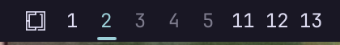

# omarchy-workspaces



An Omarchy 4.5 shell bar-widget plugin cloned from the built-in
`omarchy.workspaces`.

The built-in widget follows Omarchy's per-monitor workspaces: each monitor
owns a block of ten, and each bar shows its own block numbered 1-10. This
plugin instead keeps one flat strip of global, absolute workspace numbers:
1-22, with workspace 10 labeled `0` as on the keyboard. The first five are
always shown; other existing workspaces appear up to 10, or up to 22 when
`showExtended` is set.

It carries the 4.5 bar's workspace behavior onto that numbered strip:

- The current workspace is the one this bar's monitor shows, marked with the
  accent color and an underline.
- Clicking the current workspace runs the stock layout cycle
  (`omarchy-hyprland-workspace-layout-toggle`); clicking any other workspace
  focuses that absolute number. The underline is the only active-workspace
  marker; there is no extra layout badge.
- The wheel scrolls one workspace per notch through the numbers shown, and
  holds at either end instead of wrapping.
- `omarchy-shell omarchy.workspaces refresh` refreshes the live monitor and
  workspace state.

## Install

```bash
omarchy plugin add https://github.com/houz42/omarchy-workspaces.git --enable
```

This widget replaces the built-in `omarchy.workspaces` and answers its IPC
target. Disable or remove the built-in widget from the bar rather than
placing both at once.

## Settings

Extended workspaces 11-22 are hidden from the bar by default. To show them,
set `showExtended` on the widget's entry in `~/.config/omarchy/shell.json`:

```json
{
  "id": "houz42.workspaces",
  "showExtended": true
}
```
